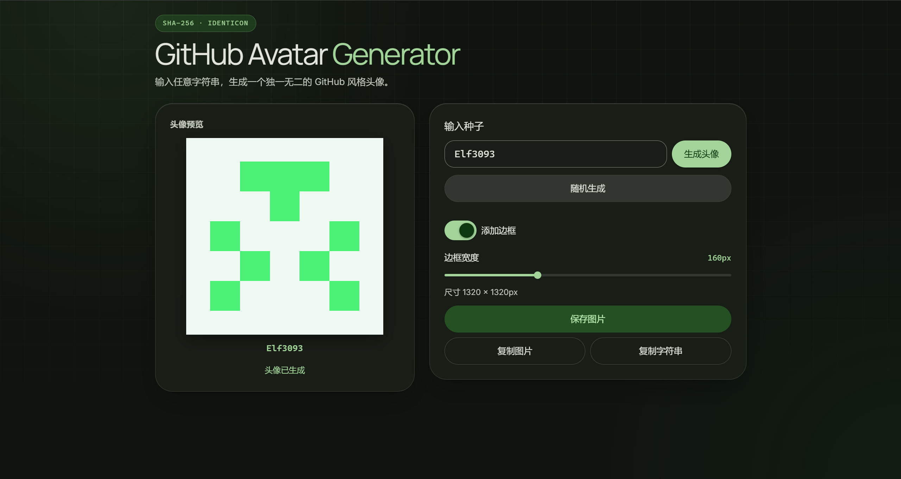

# GitHub Avatar Generator

**输入字符串，生成 GitHub 风格头像**  
_Generate GitHub-style identicons from any string_

---

## Live Demo | 在线体验

[https://tuning-luna.github.io/github-avatar-generator/](https://tuning-luna.github.io/github-avatar-generator/)

## Docs | 文档

- [Features | 特性](./docs/features.md)
- [Run locally | 本地运行](./docs/run-locally.md)
- [Verify | 验证](./docs/verify.md)
- [How It Works | 工作原理](./docs/how-it-works.md)
- [License](./docs/license.md)
